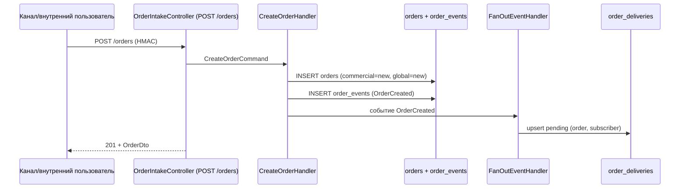
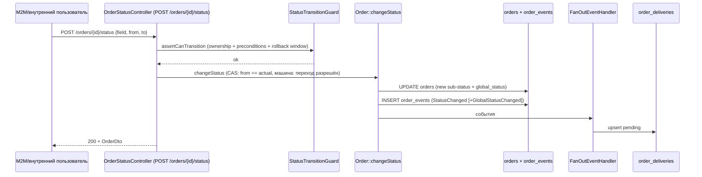

# Локальная копия "Модуль Orders — документация"

> **Путь:** `modules/order/`
> **Назначение:** центральный source of truth для заказов (заявок) экосистемы Script Agency + event bus для внешних систем-подписчиков (CRM, legal, resume).

---

## Содержание

- [Зачем нужен модуль](#зачем-нужен-модуль)
- [Ключевые понятия](#ключевые-понятия)
- [Архитектура](#архитектура)
- [Как читать документацию](#как-читать-документацию)
- [Связанные документы](#связанные-документы)

---

## Зачем нужен модуль

До появления модуля у экосистемы не было **единого источника правды** по заказам:

- заказ мог жить в нескольких системах одновременно, и было непонятно, какой статус «настоящий»;
- смена статуса в одной системе не доходила до остальных;
- не было аудита — кто, когда и почему перевёл заказ в то или иное состояние;
- автоматизированные пайплайны (производство, юрсистема, резюме) не имели надёжного канала получения изменений.

Модуль `orders` решает эти задачи:

1. **Source of truth.** Все заказы экосистемы регистрируются в таблице `orders`. Любая система читает актуальное состояние из одного места.
2. **Строгие статусные машины.** Каждый под-статус (коммерческий, производственный, юридический, оплата) переходит только по разрешённым маршрутам. Независимо от того, кто шлёт запрос, невалидный переход отклоняется.
3. **Производный `global_status`.** Никто не пишет его напрямую — он пересчитывается при каждом изменении любого под-статуса (см. [state-machines.md](state-machines.md)).
4. **Event log.** Каждое изменение статуса и каждое создание заказа фиксируется в append-only таблице `order_events` — это и аудит, и источник событий для подписчиков.
5. **Event bus / fan-out.** При каждом событии модуль раскладывает pending-доставки для активных подписчиков (`order_deliveries`), а фоновый воркер доставляет их по вебхукам с ретраями (см. [delivery-and-retries.md](delivery-and-retries.md)).
6. **Обратный поток.** Внешние системы могут сообщать о своих действиях (например, «перевели в production», «договор подписан», «счёт оплачен») через вебхуки или M2M API — но только в рамках своей зоны ответственности (ownership).
7. **Идемпотентность и надёжность.** Повторная отправка с тем же ключом не создаёт дублей; доставка событий гарантируется ретраями и подтверждениями (ack).

### Кто участвует

| Участник | Роль |
|----------|------|
| **Passport** | Центральный сервис: хранит заказ, статусы, события; доставляет события подписчикам |
| **CRM (TASKFLOW CRM)** | Подписчик `crm`; владеет полем `production_status`; отправляет статус-репорты обратно |
| **Legal-система** | Подписчик `legal`; владеет полем `legal_status`; пока не подключена |
| **Resume-система** | Подписчик `resume`; пока не подключена |
| **Внутренние пользователи** | Менеджеры/админы Passport: создают заказы, ведут коммерческий этап и оплату, администрируют |
| **Каналы intake** | Сайт, Telegram, API, ручной ввод — источники создания заказов |

---

## Ключевые понятия

| Понятие | Описание |
|---------|----------|
| **Заказ (Order)** | Агрегат в таблице `orders`: id, source, idempotency_key, ссылки на компанию/заказчика/менеджера, под-статусы, global_status, метаданные |
| **Sub-status** | Одно из четырёх полей: `commercial_status`, `production_status`, `legal_status`, `payment_status` |
| **Global status** | Производное поле, пересчитывается `GlobalStatusCalculator` при каждом изменении под-статуса |
| **Событие (event)** | Неизменяемая запись в `order_events` (event log): тип, payload, актор, источник, время |
| **Подписчик (subscriber)** | Внешняя система в `order_subscribers` с webhook URL, HMAC-секретом и фильтром событий |
| **Доставка (delivery)** | Строка в `order_deliveries` = пара (заказ, подписчик); состояние: pending/processing/failed/delivered/acked/dead; для processing новое событие временно хранится в queued_event_id |
| **Fan-out** | Разворачивание события в pending-доставки для всех активных подписчиков |
| **DeliveryWorker** | Фоновый процесс, забирает pending/failed доставки и шлёт вебхуки с ретраями |
| **HMAC-подпись** | `sha256=hash_hmac('sha256', timestamp . '.' . body, secret)` — подпись исходящих вебхуков и проверка входящих |
| **Idempotency key** | Ключ `[A-Za-z0-9:_\-]{1,64}`; повтор запроса с тем же ключом не создаёт дублей |
| **Ack** | Подтверждение подписчиком, что событие получено (статус доставки → `acked`) |

---

## Архитектура

Модуль построен по Clean Architecture + DDD + CQRS (как и остальные модули Passport):

```
modules/order/
├── application/          # Прикладной слой: команды, запросы, DTO, сервисы, хендлеры, порты
├── config/               # DI-контейнер, маршруты, параметры
├── domain/               # Доменный слой: enum, VO, entity, событий, state-машины, репозитории (интерфейсы)
├── infrastructure/       # AR-модели, Db-репозитории, HMAC, HTTP-клиент, DeliveryWorker, миграции
├── presentation/         # Контроллеры, middleware, request-модели, консольные команды
└── Module.php
```

Поток создания заказа:



Поток смены статуса:



### Ключевые классы

| Слой | Класс | Назначение |
|------|-------|------------|
| domain | `Order` | Агрегат: статусы, CAS, пересчёт global, pending-события |
| domain | `StateMachineRegistry` | Карта поле → машина состояний |
| domain | `*StatusMachine` | 4 чистые state-машины (commercial/production/legal/payment) |
| domain | `GlobalStatusCalculatorInterface` | Чистая функция расчёта global_status |
| application | `GlobalStatusCalculator` | Реализация таблицы решений |
| application | `StatusTransitionGuard` | Ownership + preconditions + окно пост-релиза |
| application | `StatusOwnershipRegistry` | Матрица «кто пишет поле» |
| application | `CreateOrderHandler` | Создание заказа с идемпотентностью и fan-out |
| application | `ChangeStatusHandler` | Смена статуса в транзакции |
| application | `FanOutEventHandler` | Разворачивание событий в pending-доставки |
| infrastructure | `DbOrderRepository` | optimistic-lock (`WHERE version`), `FOR UPDATE` |
| infrastructure | `DbDeliveryRepository` | `FOR UPDATE SKIP LOCKED` для claimPending |
| infrastructure | `DeliveryWorker` | Доставка вебхуков с ретраями |
| infrastructure | `HmacSigner` / `HmacVerifier` | Подпись и проверка вебхуков |
| presentation | `HmacVerificationMiddleware` | Проверка входящих HMAC-запросов |
| presentation | 6 контроллеров | intake / чтение / status / ack / webhook / admin |

---

## Как читать документацию

| Если вы... | Читайте |
|------------|---------|
| Хотите понять статусы и переходы | [state-machines.md](state-machines.md) |
| Интегрируете внешнюю систему (клиент или приёмник) | [integration.md](integration.md) + [webhook-consumer-guide.md](webhook-consumer-guide.md) |
| Нужен справочник API и команд | [api.md](api.md) |
| Нужны DTO, события, формат конверта | [dto-and-events.md](dto-and-events.md) |
| Эксплуатируете и диагностируете | [administration.md](administration.md), [delivery-and-retries.md](delivery-and-retries.md) |
| Работаете с БД/миграциями | [migrations.md](migrations.md) |

---

## Связанные документы

- [Переходы статусов и global_status](state-machines.md)
- [Архитектура и механизмы](architecture.md)
- [API и команды](api.md)
- [DTO и события](dto-and-events.md)
- [Доставка и ретраи](delivery-and-retries.md)
- [Администрирование](administration.md)
- [Миграции и откаты](migrations.md)
- [Подключение систем](integration.md)
- [Гайд для внешних систем: приём вебхуков и ответные части](webhook-consumer-guide.md)

> **Связанные модули Passport:** [RBAC](../rbac/README.md) — доступы и permissions; [OAuth](../oauth/README.md) — M2M-токены для внешних систем.